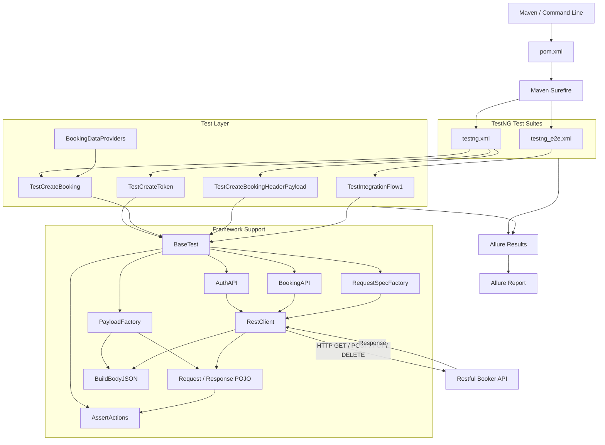
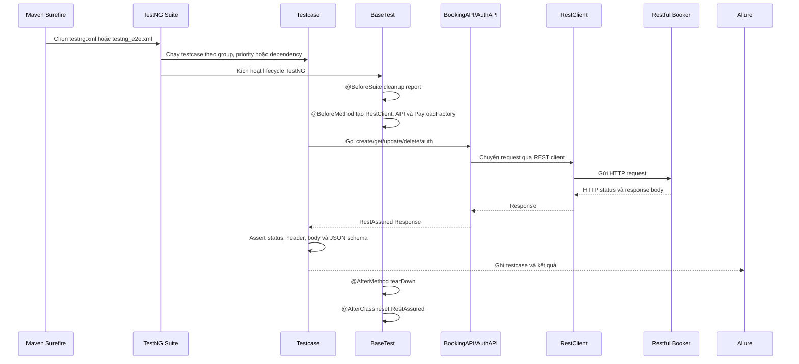
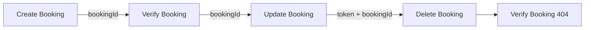

# Kiến trúc dự án

Tài liệu này mô tả kiến trúc và luồng thực thi của REST Assured API Test Framework.

## Kiến trúc tổng thể

## Luồng thực thi một testcase

## Luồng E2E

Các bước E2E được liên kết bằng `dependsOnMethods` và chia sẻ dữ liệu qua `ITestContext`.
